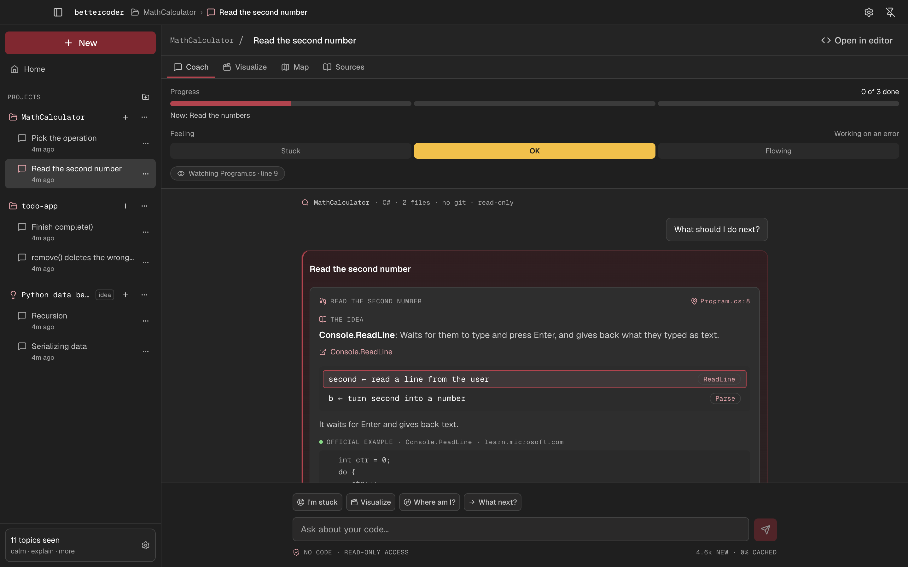
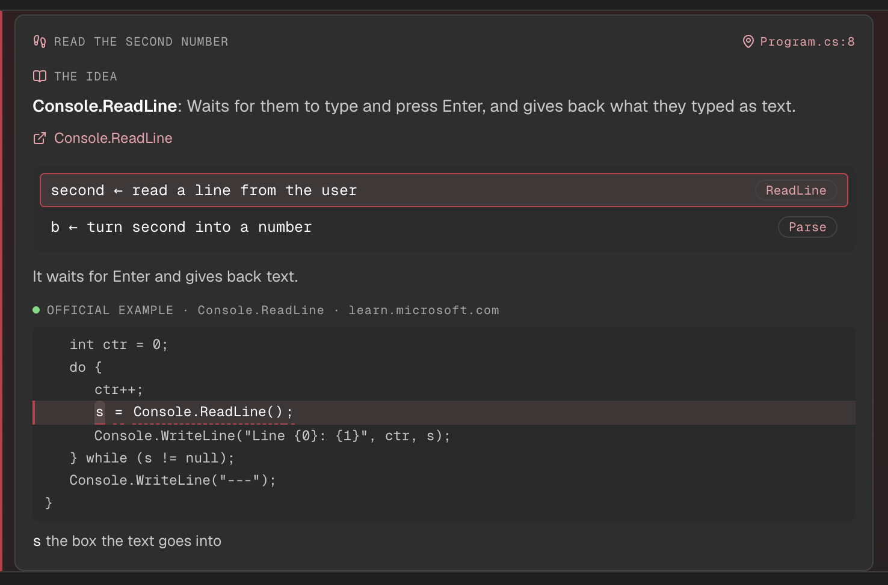
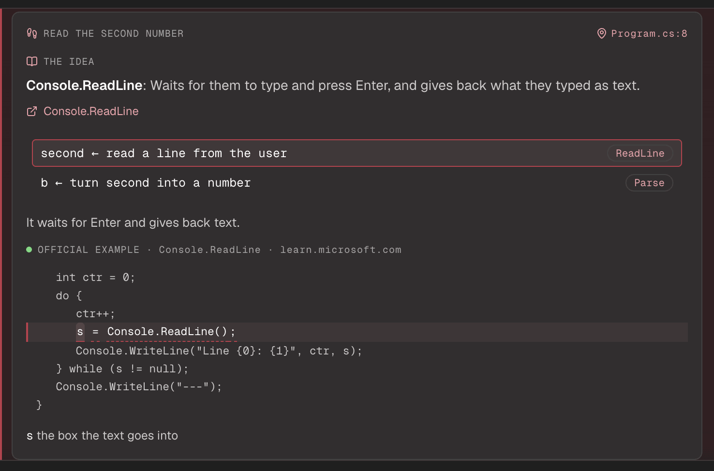
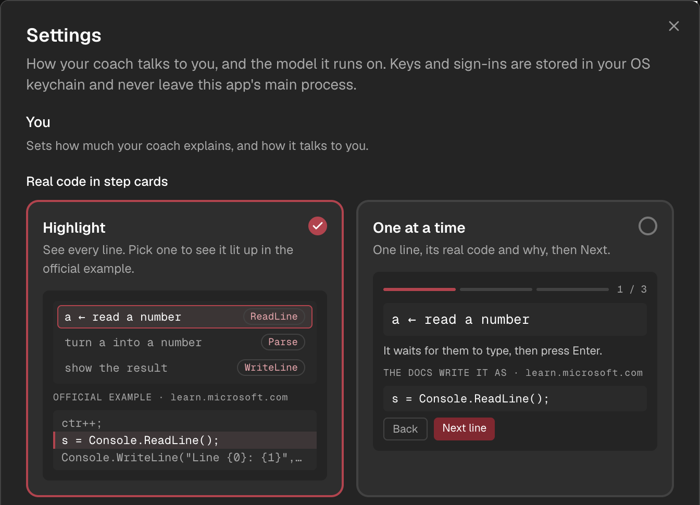
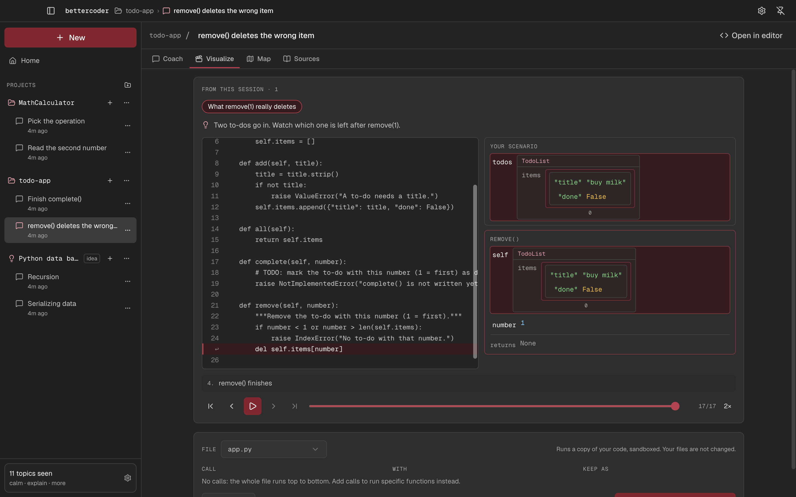
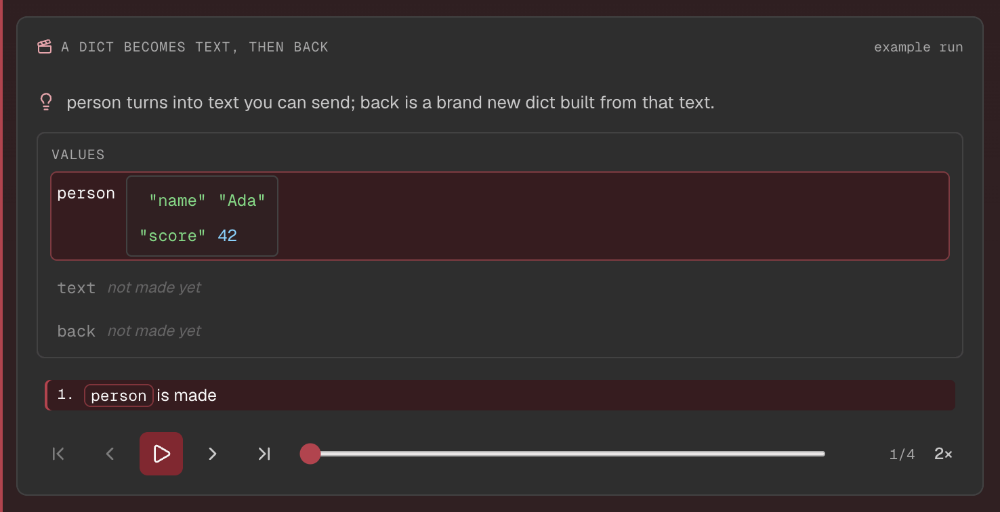
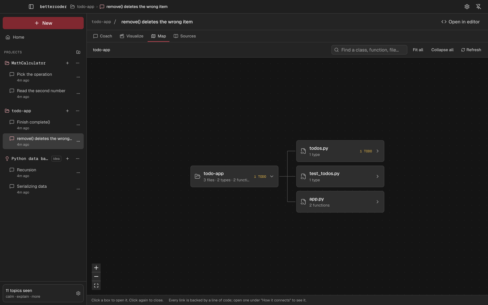
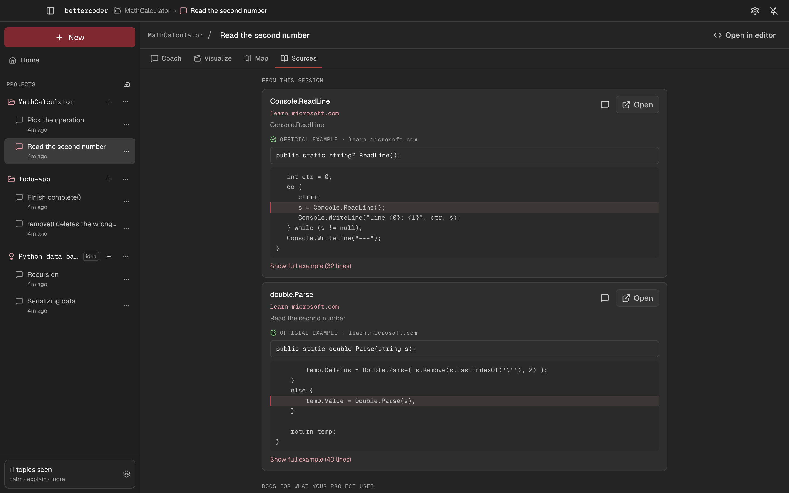
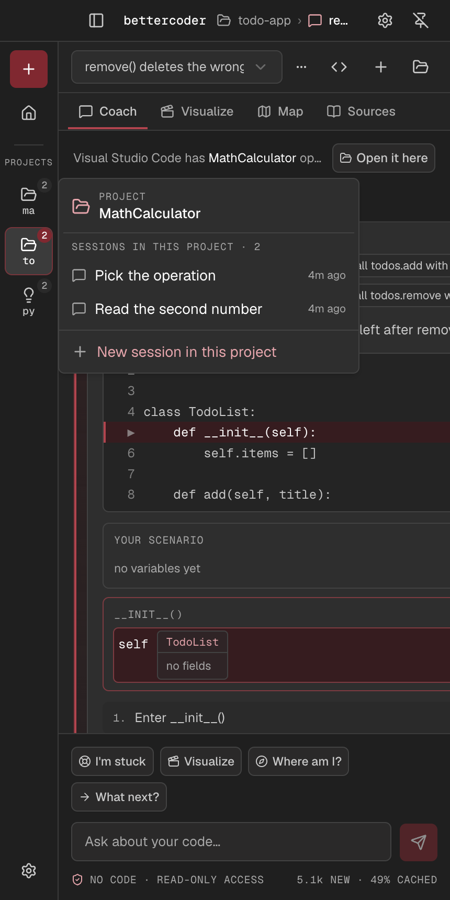

<p align="center">
  
</p>

<h1 align="center">BetterCoder</h1>

<p align="center"><b>Pseudocode, pictures and your own code running. Never the answer.</b></p>

<p align="center">
  A desktop coach that sits beside your editor and teaches you to build it yourself.
</p>

<p align="center">
  
</p>

## What it does

- **Coaches one step at a time.** Each step is one card: the idea, the pseudocode, and the real line from the official docs.
- **Never writes your code.** Every reply and card is checked before you see it; real code is sent back to be redone.
- **Runs your code and shows it.** Your Python runs on a sandboxed copy, and you step through it: the line, the variables, lists and objects drawn as boxes.
- **Shows ideas in motion.** For "how does serializing work?", the coach runs a small hidden example and you watch the values change.
- **Maps your project.** Files, classes and functions for Python, TypeScript/JavaScript, Java, C#, Kotlin, Swift and C++.
- **Works with your editor.** VS Code, Cursor or Windsurf: it marks the line to write next and shows the pseudocode faded beside it, never typed in.

## Who it's for

| | What the coach does |
|---|---|
| **New to coding** | Plain words, one small step, pictures of what your code does, and labels on each part of a real line. |
| **Knows the basics** | A hint before help, the official line one tap away, and habits for debugging. |
| **Senior, new language** | Straight to trade-offs and the spec. Levels are per topic, so you can be pro in Python and new to C#. |

Your level is never asked. The coach judges it from evidence: your code, how you use the cards, and what it sees you do.

## How it works

### One step, one card

The step card shows the idea, then the pseudocode. Lines that use a real method link to the official example, lit on the line that does it.

<p align="center"></p>

For topics you're new to, tap a part of the official line to see what it does.

<p align="center"></p>

You choose how real code shows, with a preview: everything with one line lit, or one line at a time.

<p align="center"></p>

### Watch code run

Your own Python, run on a copy in a sandbox. Here `remove(1)` deletes the wrong to-do, and you can see why.

<p align="center"></p>

Ideas get a hidden example: you see the values and a numbered story, never the coach's code.

<p align="center"></p>

### Your project at a glance

<table>
  <tr>
    <td width="50%"></td>
    <td width="50%"></td>
  </tr>
  <tr>
    <td align="center">The Map: files, classes, functions</td>
    <td align="center">Sources: every official doc the coach used</td>
  </tr>
</table>

### Beside your editor

Make the window narrow and it fits next to your editor. Projects become blocks; tap one for its sessions.

<p align="center"></p>

## Get started

You need macOS (the animator uses the macOS sandbox), Node 24, and Python 3 for animations.

```bash
npm install
npm run dev        # run the app
npm run ide:link   # link the editor extension into VS Code, Cursor or Windsurf, then restart the editor
```

Then connect a model in **Settings**. BetterCoder works with 42 providers through [pi-ai](https://github.com/earendil-works/pi) (Grok, Claude, GPT and more), using your own API key. Keys are stored in your OS keychain and never leave the app's main process.

## The rules it keeps

- **No code for you, ever.** One mode, no switch. Pseudocode in step cards is checked to be language-neutral.
- **Your project is read-only.** No path escapes, secret files are refused, secrets are blanked out.
- **What you type is never word-matched.** Buttons send structured intents; your words go to the model as they are.
- **Sessions never break.** State is rebuilt from the saved conversation, so a restart picks up where you were.

## Contributing

The main process uses clean layers: the coach and services depend on interfaces (`src/main/ports`), and adapters and engines implement them. `tests/architecture.test.ts` checks this on every run.

Before a pull request:

```bash
npm test
npm run typecheck
```

After fixing a bug, add a regression test in `tests/` with a fixture.

## Licence

[AGPL-3.0](LICENSE)
